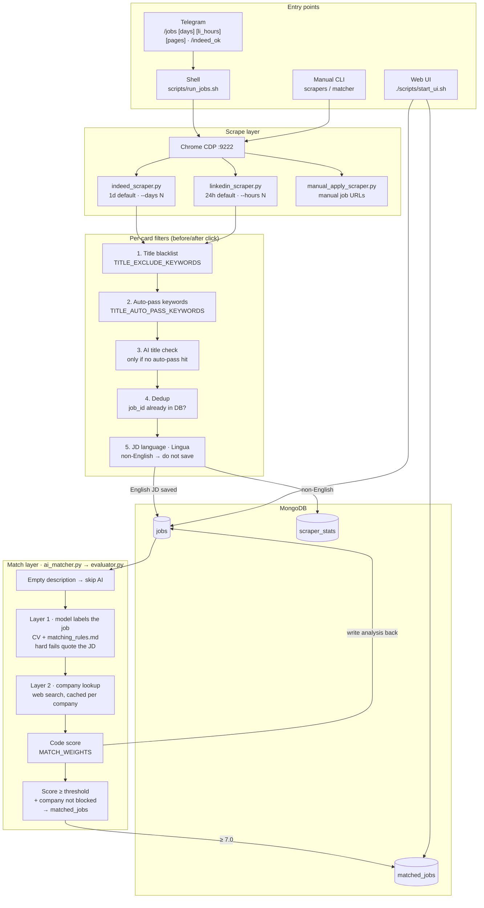
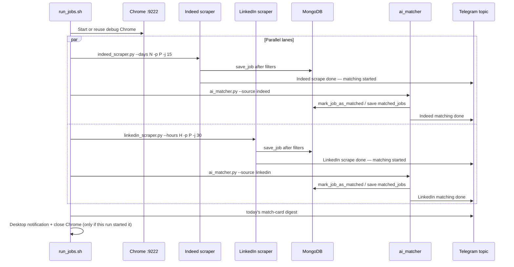
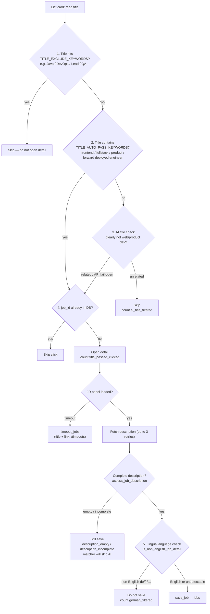
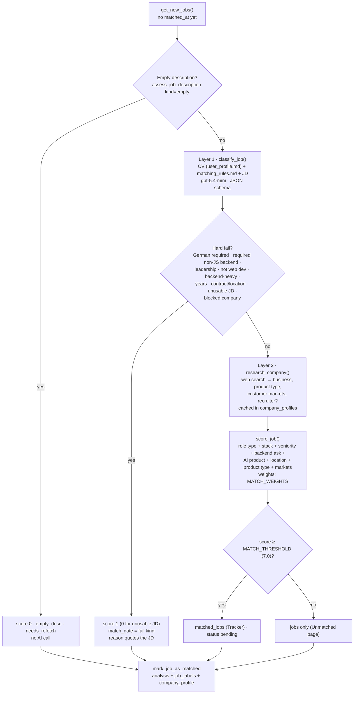

# Job Scraper — Architecture & Flows

This document describes the current architecture, entry commands, and the full chain: scrape → filter → AI match.

All project docs and code comments are written in English.

---

## 1. System overview



---

## 2. Commands / entry points

### 2.1 Pipeline

The browser pipeline (LinkedIn / Indeed) has **no schedule**: it runs on demand from Telegram `/jobs` (or the same script from a shell) on the Mac.

The **API sources pipeline** (Arbeitnow, Bundesagentur, company ATS boards; Adzuna opt-in; `src/sources/run_sources.py`) runs **daily on GitHub Actions** (`.github/workflows/api-sources.yml`, 09:17 UTC / 10:17 Berlin in winter), with no Mac needed. It uses the same title / language gates and the same AI matcher, and sends its own Telegram summary + match cards. Full source list, setup and watchlist: [`job_sources.md`](./job_sources.md).

| Command | What it does | Typical time |
|---------|--------------|--------------|
| `./scripts/run_jobs.sh [--days N] [--hours H] [--pages P]` | Indeed + LinkedIn lanes in parallel. Each source matches as soon as its scrape finishes, with Telegram pings; match-card digest after both lanes. Defaults: Indeed 1 day, LinkedIn 24h (or `days × 24` when `--days` is given), `FULL_MAX_PAGES` (3) pages per keyword on both platforms | 40–60 min at defaults |
| `python3 src/sources/run_sources.py [--sources …] [--days N] [--dry-run]` | API sources: fetch → funnel → AI match → Telegram (same as the daily GitHub Actions run). See [`job_sources.md`](./job_sources.md) | 2–8 min |
| `./scripts/start_ui.sh` | Start Job Tracker Web UI (default `:5050`); `--reload` restarts on `.py` or HTML saves; HTML is `Cache-Control: no-store` so a refresh shows template edits without a restart | — |

Prefer `caffeinate -i` for manual runs so sleep does not interrupt Playwright:

```bash
caffeinate -i ./scripts/run_jobs.sh                              # both last 24h, 3 pages/keyword
caffeinate -i ./scripts/run_jobs.sh --days 7                     # Indeed 7d, LinkedIn 168h
caffeinate -i ./scripts/run_jobs.sh --days 3 --hours 72 --pages 2
```

### 2.2 Telegram bot commands

| Command | Purpose |
|---------|---------|
| `/start` | Confirm bot is online |
| `/test` | Confirm the Mac is connected and ready |
| `/jobs [days] [linkedin_hours] [pages]` | Run `scripts/run_jobs.sh` in the background; per-source scrape/match pings; “Done” when both lanes finish. `days` ∈ 1/3/7/14 (Indeed), `linkedin_hours` defaults to `days × 24`, `pages` applies to both platforms. Examples: `/jobs`, `/jobs 7`, `/jobs 3 120`, `/jobs 3 72 2` |
| `/indeed_ok` | Resume Indeed after human verification (also: inline **Continue** button) |

**Per-source progress:** each lane sends two short Telegram notes — scrape done (matching started), then matching done. Indeed and LinkedIn do not wait for each other to start matching.

**Match card push:** `scripts/run_jobs.sh` calls `tg.digest.push_todays_matched_jobs()` only after **both** lanes finish. That covers Telegram `/jobs` and any manual shell run.

**Single-flight lock:** `scripts/run_jobs.sh` writes `logs/pipeline.pid`. A second `/jobs` or shell run exits immediately instead of launching another debug Chrome (same `--user-data-dir` would kill the first Chrome and abort Indeed with `TargetClosedError`). Telegram also checks this pidfile. If Indeed’s tab still dies mid-run, `indeed_scraper` reconnects over CDP and retries that page instead of exiting 1.

**Destination:** Job cards, pipeline Done/error status, and Indeed challenge alerts go to the configured forum topic (`TELEGRAM_CHAT_ID` + `TELEGRAM_MESSAGE_THREAD_ID` — Jiali Personal Hub → Job Assistance). Command authorization stays on `TELEGRAM_ALLOWED_USER_ID` (your personal account). Slash-command replies (`/start`, Started, …) stay in the topic you typed in; send commands from Job Assistance so those stay there too.

Start the bot: `python3 src/tg/bot.py`

### 2.2.1 Indeed human verification handshake

Indeed sometimes shows a captcha / “press and hold” challenge. The scraper **does not solve** that check. It:

1. Detects the challenge page (URL / captcha widgets / challenge copy)
2. Sends a Telegram alert with a **Continue** button
3. Pauses (up to 45 minutes) until **either** the job list is back in Chrome **or** you confirm
4. Reloads the SERP and continues the same keyword / page

You complete the check in the debug Chrome window. When the SERP returns, the scraper continues on its own. Optional confirm: tap **Continue**, send `/indeed_ok`, or (bot offline) `touch logs/indeed_human_resume.flag`.

If Indeed’s tab/browser closes mid-run (`TargetClosedError`), the scraper reconnects to the debug Chrome and retries the current results page instead of aborting the lane.

Indeed pacing is slower and more human-like than LinkedIn: random think-time before each card click, hold-delay on click, longer rests between cards (~5–11s), pages (~35–80s), and keywords (~30–70s).

### 2.3 Standalone CLI (debug / partial runs)

| Command | Purpose |
|---------|---------|
| `python3 src/scrapers/indeed_scraper.py [-k …] [-p N] [-j N] [--days N]` | Indeed only, no matching (default 3 pages × 15, last 1 day) |
| `python3 src/scrapers/linkedin_scraper.py [-k …] [-p N] [-j N] [--hours N]` | Full LinkedIn keyword loop (default 3 pages × 30; `--hours` < 24 → 2 pages; time window default config 24h, or `--hours`) |
| `python3 src/matching/ai_matcher.py [-l N] [-s source] [-t 7.0]` | AI match only (jobs without `matched_at`) |
| `python3 src/scrapers/manual_apply_scraper.py <urls…>` | Manual job URLs → `matched_jobs` (default `status=pending`; `--status applied` optional). Already on Tracker with a full card: skip, or mark applied when requested. Link-only / `ai_pending` Tracker rows are scraped in place (notes / timeline kept). Chrome / Indeed / AI failure still saves a **new** URL stub (`ai_pending`). `--link-only` skips scrape/AI. |
| `python3 scripts/tools/log_recommended_jobs.py <jobs.json \| ->` | Local twin of `POST /api/agent/jobs`. Batch log agent picks as link-only Tracker stubs: `pending`, `recommended_by` from `--recommended-by` (default `claude`; per-job `recommended_by` wins), per-job title / company / location. No browser / no AI; a job_id already in `matched_jobs` / `jobs` / `timeout_jobs` is skipped with no write. Score later with Tracker **Select missing details** → **Run AI for selected**. |
| `python3 scripts/db/cleanup_excluded_titles.py …` | Cleanup DB rows by title blacklist |
| `python3 scripts/tools/eval_matcher.py …` | Matcher evaluation |
| `python3 scripts/tools/eval_matcher.py [--pos N --neg N --german N] [--job-model M]` | Check the matcher against Tracker decisions (applied vs unsuitable) and re-check old German rejects. `--unapplied [--limit N]` scores Tracker jobs she did not apply to. `--from-results <file>` re-scores a saved run with the current weights (no API calls). Read-only on MongoDB (company lookups cached in `evals/results/company_cache.json`); output in `evals/results/`. |

---

## 3. Pipeline — `scripts/run_jobs.sh` / `/jobs`



Order:

1. Chrome remote debugging (reuse if `:9222` already open)
2. **Indeed + LinkedIn lanes in parallel** — `--pages` per keyword (default `FULL_MAX_PAGES` = 3). Indeed processes about 15 cards per page (`start` steps by 15). LinkedIn processes up to 30 cards per page.
3. As soon as a source finishes scraping → **AI matcher for that source only** (`--source indeed` / `--source linkedin`) + Telegram ping
4. After both lanes finish → push today's match-card digest + optionally close Chrome

The pipeline does **not** delete or clear any database rows.

Indeed search URL (`INDEED_CONFIG`): `de.indeed.com/jobs?q=<keyword>&l=&fromage=<days>`. Location stays empty (same as the desktop SERP). Hyphens in keywords are sent as spaces (`full-stack` → `q=full+stack`) so the query matches typing “Full Stack” in the search box. Indeed only offers 1, 3, 7 or 14 days.

LinkedIn time window: `f_TPR=r<hours × 3600>`.

Budgets are defined in `src/core/config.py` (`FULL_MAX_PAGES`, `INDEED_JOBS_PER_PAGE`, `LINKEDIN_JOBS_PER_PAGE`, `LINKEDIN_SHORT_WINDOW_MAX_PAGES`). `run_jobs.sh` reads them at start; `--pages` overrides `FULL_MAX_PAGES`. A standalone `linkedin_scraper.py --hours N` run without `-p` uses `linkedin_default_max_pages(hours)`.

---

## 4. Per-job funnel: list card → database

For every list card during scrape:



### What each stage does

| Step | Implementation | Purpose |
|------|----------------|---------|
| 1. Title blacklist | `is_title_excluded()` · `TITLE_EXCLUDE_KEYWORDS` | Skip clearly wrong roles before clicking. `Cloud` only matches Cloud Engineer / Architect / similar roles, not “Cloud SaaS” in a frontend title. |
| 2. Auto-pass hit | `title_matches_auto_pass()` · `TITLE_AUTO_PASS_KEYWORDS` | frontend / full-stack / fullstack / product / forward deployed engineer → click without AI. `software engineer` is a search keyword (`DEFAULT_KEYWORDS`) but **not** auto-pass, because it also matches embedded / HMI / data titles |
| 3. AI title screen | `is_title_relevant_by_ai()` (`AI_MODEL`, default gpt-4.1-mini) | After blacklist + no auto-pass: the prompt describes a JS/TS web engineer and skips only titles that are clearly not web/product development (embedded, HMI/Qt, data/BI, integration, growth/marketing, DevOps, QA, sales, other language stacks). Unsure → open. API error → open |
| 4. Dedup | `is_job_id_exists()` | Do not re-open known jobs |
| 4b. Detail timeout | `save_timeout_job()` | Title passed but JD panel missing → `timeout_jobs` for `/timeouts` |
| 4c. LinkedIn JD body | `extract_linkedin_description()` | About-the-job region only (`JobDetails_AboutTheJob_*`). Expands See more / Mehr anzeigen. Never the whole SDUI `lazy-column` (top card + teaser + similar jobs). |
| 4c2. LinkedIn applicants | `extract_linkedin_applicants()` | Short phrase from classic top-card or SDUI details (`25 applicants`, `Be among the first 25`). Stored as `applicants`; shown on Tracker / Unmatched List rows. |
| 4d. JD completeness | `assess_job_description()` | Too short, UI chrome, similar-jobs sidebar, or title/company mismatch → save with `description_incomplete` (or `description_empty`); matcher skips AI |
| 5. JD language | `is_non_english_job_detail()` · Lingua | **JD body not English** (usually German posts) → **do not save**. UI: German Filtered |

> Step 5 answers “what language is the JD written in?”, not “does an English JD require German skills?”. The latter is the match-stage German gate. Incomplete English teasers are saved and skipped at match, not sent to the model.

Unified title-gate entry point:

`should_skip_title_before_click()` → `src/core/scraper_utils.py`

---

## 5. After save: AI matching

`ai_matcher.py` only processes `jobs` documents that still lack `matched_at`. Each job goes through `matching/evaluator.py`:



**Who decides what**

| Step | Decided by |
|------|------------|
| Empty JD | Code (`assess_job_description`) — no API call |
| Job labels and hard fails | Model (`MATCH_JOB_MODEL`, default `gpt-5.4-mini`), rules in [`matching_rules.md`](./matching_rules.md). Every hard fail and German requirement must quote the posting |
| What a label does | Code (`score_job`). Only `backend_language_ask = required_non_js` fails on backend; `implied_non_js` is −1. Duties like "lead a squad / lead projects" → `lead_or_above` (−3) |
| Company business / markets | Model with web search (`MATCH_COMPANY_MODEL`), cached per normalised company name in MongoDB `company_profiles`. Only for jobs that passed layer 1 |
| Final score | Code, `MATCH_WEIGHTS` in `src/core/config.py`. Tune preferences there, not in prompts |
| Tracker cut-off | `MATCH_THRESHOLD` (`.env`, default 7.0) and `MATCH_BLOCKED_COMPANIES` (case-insensitive) |

**Stored fields:** `match_score`, `match_gate` (`scored`, `german`, `stack`, `leadership`, `not_web_dev`, `backend_heavy`, `too_many_years`, `contract_or_location`, `blocked_company`, `incomplete_desc`, `empty_desc`, `score_failed`; older rows may still carry `ai_ml`), `disqualification_reason` (quote), `summary`, `match_reasons` (Business / Customers/markets / Stack / score breakdown), `red_flags` (watch-out), `job_labels`, `company_profile`. JDs are never cleared.

**Scrape-time language filter vs German requirement:** Lingua (`scraper_utils.is_non_english_job_detail`) drops postings *written* in another language before they are saved. A German requirement inside an English JD is a layer-1 hard fail (`german_required` + quote); German as a plus / "German or English" passes.

If the OpenAI account runs out of credits, matching stops and the remaining jobs stay without `matched_at` for the next run.

Already-scored jobs are not rematched automatically. To re-score one: Unmatched **Can Apply** → Tracker **Re-run AI**, or clear `matched_at` on that `jobs` row and run `ai_matcher.py`.

---

**Timeouts page (`/timeouts`):** cards whose **title already passed** the scrape gates but the detail panel did not load in time. These are not saved to `jobs` (no JD). You open the original link and, if it is a real match, **Add as Not Applied** — that copies the card into `matched_jobs` as `pending`. Cards with no readable title (typical Indeed ad/empty slots, ~1 per SERP page) are not listed.

**Unmatched page (`/unmatched`):** any job below the match threshold can be marked **Can Apply** (`user_status=watchlist`). That copies it into `matched_jobs` as `pending` (does not overwrite an existing Tracker row) so it can be tracked or marked applied. This is a manual override when AI scoring was wrong; it is not limited to the 6–7 score band. Filter by hard-fail kind with the gate dropdown; each card shows the quoted reason plus the company / score breakdown.

**Tracker / Unmatched Cards layout:** collapsed cards show score, title, company and location only (same face on both pages: title, then company + location chip). A click or tap opens the same side details sheet as List (with a Close ×); the board card stays in the grid.

**Tracker / Unmatched List layout:** the company line also shows LinkedIn applicant count (`applicants` when scraped). On Tracker, a saved `#N at apply` (`applicant_position`) replaces that scraped phrase on the row.

**Sidebar:** from Tracker, Log a job / Timeouts / Unmatched open in a new tab so the job list stays. Switching among those three pages stays in the same tab.

**Overview pipeline rail:** one bar to scale where the full width is every opened job (`title_passed_clicked`). Parts: not in English (grey) · in English not matched · AI matched, with **Applied** inside matched, **Got interview** inside Applied (same lookback as the Got interview chip: invite / a round / offer, including later rejected), and **Offer** inside Got interview. Volume percentages (through Applied) are a share of opened jobs. **Got interview** and **Offer** are a share of Applied (interview rate and offer rate among applications), not of opened jobs. Offer stays in the readout at 0 so the slot is reserved. On a phone the colour strip is 14px; labels sit under the bar.

**Tracker Other statuses:** `unsuitable`, `closed`, `repost`, `duplicate` are overlays on a card. They do **not** clear `applied_at` or `application_timeline`; a job that was applied still shows its progress and still counts in funnel / Journey / Locations / daily-activity applied totals. Reset Not Applied (`pending`) is the explicit wipe: it clears the timeline, `applied_at` and `applicant_position` and is not counted as an application. `repost` is a manual mark when the same role was posted again as a new listing and does not need another application. `duplicate` marks a listing already tracked from another source (e.g. LinkedIn and Indeed for the same role). Tracker chips **Applied / Interview / Offer / Rejected** filter and count by that progress (latest timeline step, or `applied_at` / flat applied-like status when there is no timeline), not exclusively by the `status` field — so an Unsuitable card with an interview step still appears under Interview, with the overlay pill still visible. **Got interview** is a lookback chip: any job that ever reached Invite / a round / Offer, including ones later marked Rejected or a side overlay. Applied→Rejected with no interview step stays on Rejected only. Overlay chips still filter by the side-status field.

AI `special_match` / `special_match_reasons` are still written by the matcher for scoring (9–10 band) but are **not** shown as badges on the Tracker. Highlight badges on the matched-jobs page come only from the user-editable `highlights` list (`PATCH /api/jobs/<id>/highlights`).

**Tracker company history:** `GET /api/jobs` (and `GET /api/jobs/<id>`) attach `company_history` / `company_history_total` to each job: the other `matched_jobs` rows with the same company (case-insensitive exact match, one query per page). Cards show a "N× before" pill and, when expanded, a "seen this company before" box with each earlier job's outcome (Rejected / Applied · no reply yet / Interview / Not Applied / side status). Clicking a company name adds it as a chip in the search box (`?company=`, exact match, OR if several). The first chip resets the other filters so every job at that company is listed; later chips add companies. Each chip has its own ×. "Show all jobs at …" still opens a new tab with that one company.

**Applicant position (LinkedIn):** `applicant_position` is a user-entered integer ("I was applicant #N when I applied"), saved with `PATCH /api/jobs/<id>/applicant-position`. It is separate from the scraped `applicants` text; scrapers and Log Job never write it. On the details sheet it sits in Application progress, above Notes (filled at apply time). Tracker List shows `#N at apply` on the row when this is set, otherwise the scraped count.

---

## 7. Directory map

```
job_scraper/
├── docs/
│   ├── architecture.md          # this file
│   ├── matching_rules.md        # layer-1 rules for the model (hard fails, labels)
│   ├── job_sources.md           # every way jobs come in + API sources / ATS setup
│   ├── user_profile.md          # resume / profile
│   ├── deployment/              # Render setup + deployment report
│   └── archive/testing/         # past one-off test / verification reports
├── src/
│   ├── core/
│   │   ├── config.py            # keywords, title blacklist, platform URLs
│   │   ├── db_mongo.py          # Mongo facade (`from core.db_mongo import …`)
│   │   ├── mongo/               # Mongo implementation (not flat mongo_*.py siblings)
│   │   │   ├── client.py        # connection pool, indexes
│   │   │   ├── jobs.py          # scrape-store CRUD + matcher write-back
│   │   │   ├── lookup.py        # known-job lookup + timeout review
│   │   │   └── tracker.py       # unmatched list, application counts, heatmap
│   │   ├── applied_location.py  # Germany + Remote bubble labels (no Mongo)
│   │   ├── country.py           # Tracker country (agent field or location guess) + filter query
│   │   ├── job_url.py           # Log Job URL parse / Indeed jk= / stubs
│   │   ├── manual_log.py        # Save Link Only / stub save (no Playwright)
│   │   ├── scraper_utils.py     # title gates, Lingua, CDP helpers
│   │   ├── challenge_wait.py    # Indeed captcha detect + auto-continue / Telegram resume
│   │   ├── pipeline_lock.py     # Single-flight pidfile for scripts/run_jobs.sh
│   │   └── dedup.py             # Cross-source duplicate check (company + title) for API sources
│   ├── scrapers/                # Indeed / LinkedIn / Manual
│   ├── sources/                 # API sources: Arbeitnow / Bundesagentur / Adzuna / company ATS (run_sources.py)
│   ├── matching/
│   │   ├── ai_matcher.py        # match orchestration (`evaluate_job`)
│   │   └── evaluator.py         # layer 1 labels, layer 2 company lookup, code score
│   ├── web/                     # Tracker UI (Flask)
│   │   ├── web_app.py           # app entry: config, login manager, registers Blueprints
│   │   ├── auth.py              # single-user login Blueprint
│   │   ├── status.py            # status + application timeline rules (pure, no Flask)
│   │   ├── list_query.py        # Tracker list filters → Mongo query
│   │   ├── serialize.py         # Mongo doc → card JSON, company history
│   │   ├── chrome_tasks.py      # Log Job / Run AI / batch Fetch state + locks (one Chrome)
│   │   └── routes/              # Blueprints, no URL prefix: pages, jobs, unmatched,
│   │                            #   timeouts, stats, log_job, ai_tasks
│   └── tg/                      # Telegram — package is not named `telegram` (would shadow python-telegram-bot)
│       ├── bot.py               # Bot: commands in (/jobs, /indeed_ok)
│       ├── client.py            # Push out: sync Bot API sendMessage helper
│       └── digest.py            # Today's match cards → Telegram (after run_jobs.sh / run_sources.py)
└── scripts/
    ├── run_jobs.sh              # pipeline behind Telegram /jobs
    ├── start_ui.sh              # Tracker web UI
    ├── lib/pipeline_common.sh   # shared shell helpers (lanes, Telegram pings)
    ├── db/                      # one-off DB maintenance (cleanup_excluded_titles.py)
    └── tools/                   # eval_matcher, generate_password_hash, log_recommended_jobs
```

---

## 8. One-line funnel

> **Title gates (blacklist → auto-pass keywords → AI title) → open detail → discard non-English JD → save English JD → matcher skips empty desc → model labels the job against CV + rules (hard fails quote the JD) → model looks up the company (cached) → code scores with MATCH_WEIGHTS → ≥ 7 and company not blocked enters Tracker.**

`/jobs` arguments only change *how much* to scrape: Indeed days, LinkedIn hours, and pages per keyword (both platforms). Each source starts AI matching as soon as its scrape finishes; job cards are pushed only after both lanes complete. **Filter and match rules are the same for every window.**
